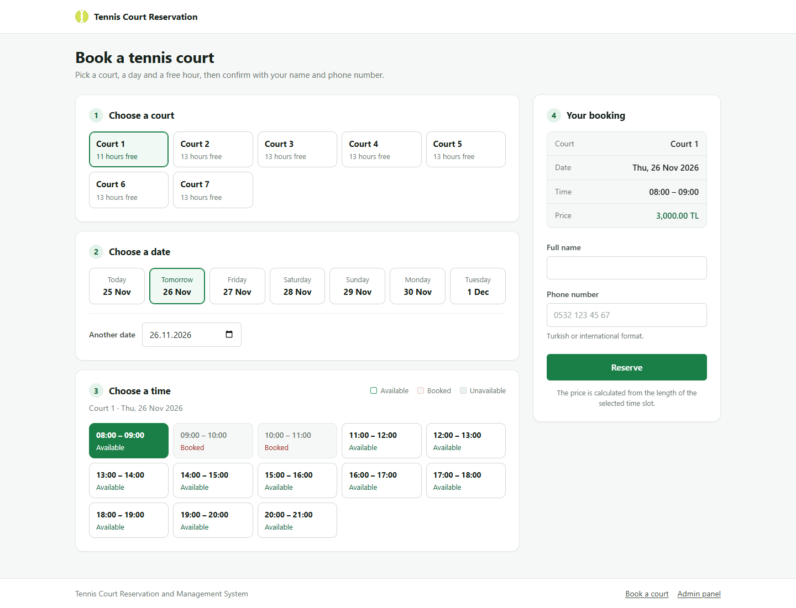
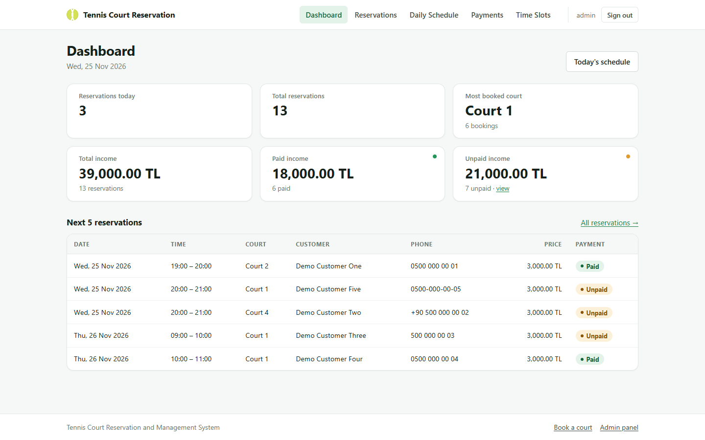
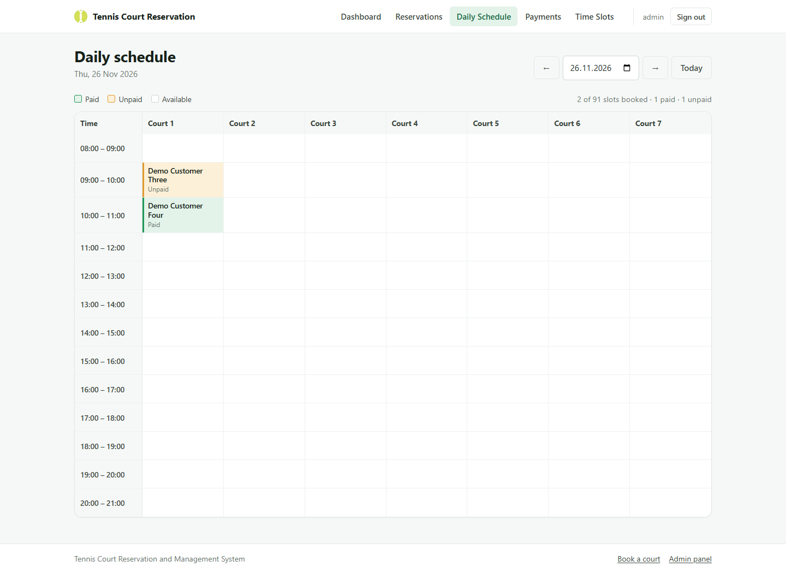
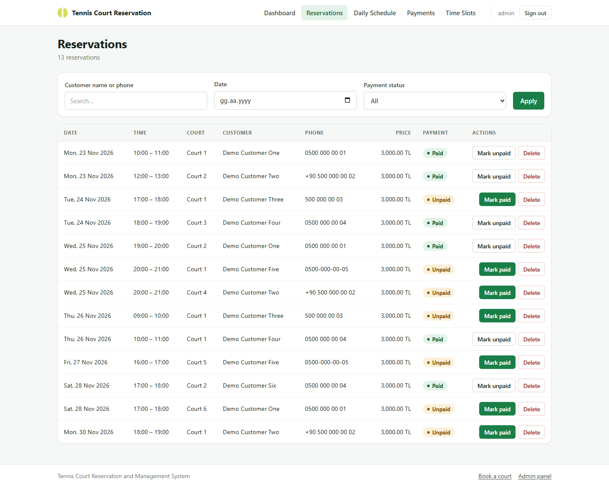
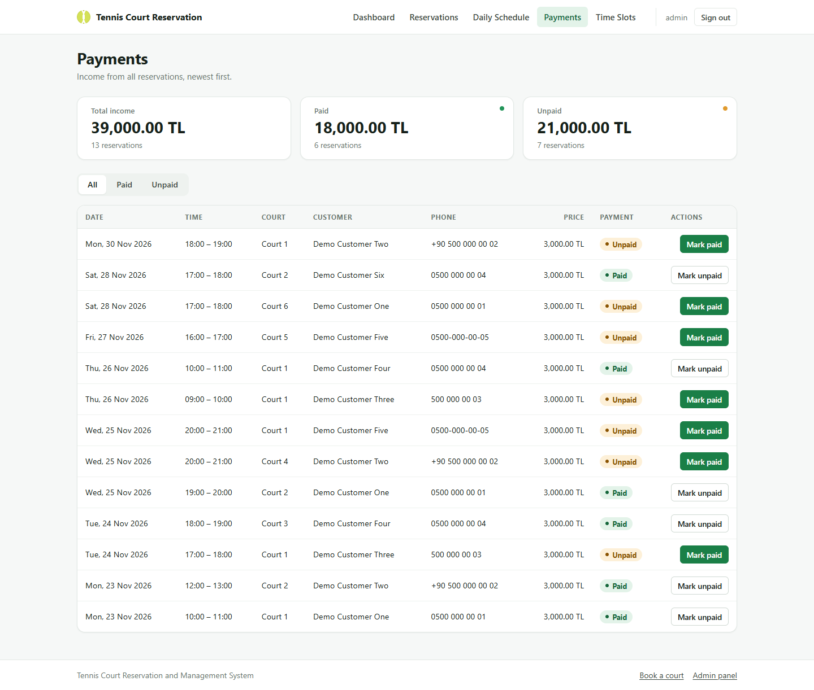
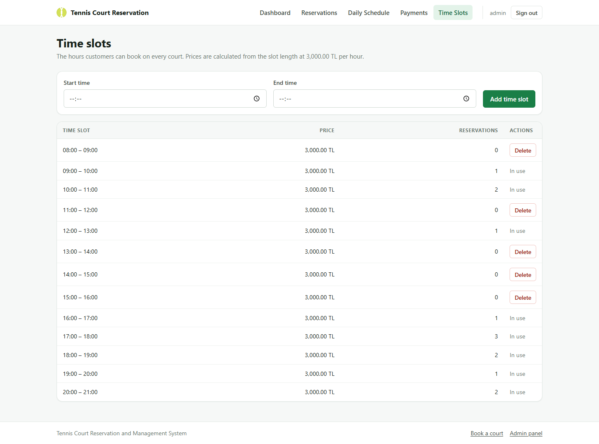
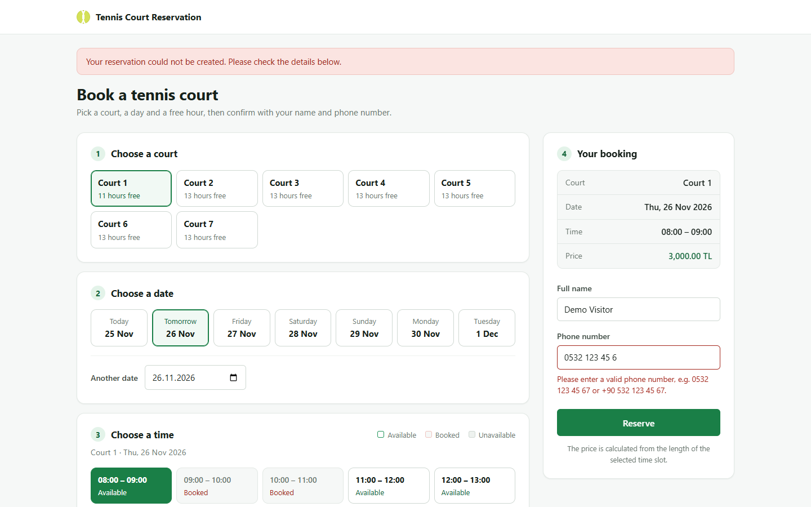

# Tennis Court Reservation and Management System

Tennis Court Reservation and Management System built with PHP, MySQL, HTML, CSS and JavaScript.

An independent software project, individually developed by **Agah Atay Özbelli**.

Customers book a court for a free hour online. Administrators manage
reservations, payments, time slots and the day's court schedule from a
password-protected admin panel.



## Contents

- [Key features](#key-features)
- [Technologies](#technologies)
- [Architecture](#architecture)
- [Database structure](#database-structure)
- [Screenshots](#screenshots)
- [Installation and setup](#installation-and-setup)
- [Usage](#usage)
- [Security](#security)
- [Testing](#testing)
- [Future improvements](#future-improvements)
- [Author](#author)
- [License](#license)

## Key features

**Customer booking**
- Choose a court (each one shows how many hours are still free), a date
  (shortcuts for the next seven days or any later date) and an available time slot
- Booked and already-started slots are shown but cannot be selected
- Name and phone number validation on the server; Turkish phone numbers are
  accepted in any common format (`0532…`, `532…`, `+90 532…`)
- Prices are calculated on the server from a configurable hourly rate and the
  length of the slot; the browser never submits a price
- Double bookings are impossible, including two customers submitting the same
  slot at the same moment (enforced by a database constraint)

**Admin panel**
- **Dashboard:** reservations today, total reservations, most booked court,
  total / paid / unpaid income and the next five upcoming reservations
- **Reservations:** search by customer name or phone (format-independent),
  filter by date and payment status, mark as paid / unpaid, delete
- **Daily schedule:** courts × time slots grid for any day, colour-coded as
  paid, unpaid or available
- **Payments:** income summary with All / Paid / Unpaid views
- **Time slots:** add or remove bookable hours (overlapping slots and slots
  that already have reservations are rejected)

## Technologies

| Layer | Technology |
|---|---|
| Backend | PHP 8.2 (no framework, no Composer dependencies), mysqli with prepared statements |
| Database | MySQL-compatible SQL, developed and tested on MariaDB 10.4 (as shipped with XAMPP) |
| Frontend | HTML5, CSS3 (one stylesheet, responsive, no CSS framework), vanilla JavaScript |
| Web server | Apache 2.4 (XAMPP) or PHP's built-in server for development |

The application is intentionally small and dependency-free. All pages work
without JavaScript; the script only adds conveniences such as confirmation
dialogs and the live booking summary.

## Architecture

```
tennis-court-reservation-system/
├── public/                     Web root: the only folder served over HTTP
│   ├── index.php               Booking page
│   ├── reserve.php             Booking form handler (POST)
│   ├── admin/                  Admin pages (dashboard, reservations, schedule,
│   │   │                       payments, time slots, login, logout)
│   │   └── actions/            POST-only handlers that change data
│   └── assets/                 CSS, JavaScript, favicon
├── src/
│   ├── bootstrap.php           Loads config, error handling, security headers, session
│   ├── config.php              Reads settings from .env
│   ├── database.php            mysqli wrapper (prepared statements, transactions)
│   ├── auth.php                Admin login, session checks, login rate limiting
│   ├── csrf.php, session.php   CSRF tokens, hardened session, flash messages
│   ├── validation.php          Dates, times, names, phone normalization
│   ├── reservation-service.php Booking rules: validation, pricing, transactional insert
│   └── repositories/           SQL for each table (plain functions)
├── templates/                  Shared layout, admin navigation, reservation table
├── database/
│   ├── schema.sql              Tables, keys and constraints
│   ├── seed.sql                Fictional sample data
│   └── migrations/             Upgrade path for databases from the original version
├── scripts/create-admin.php    Creates an administrator account (CLI)
├── tests/                      Unit tests and HTTP functional tests
└── docs/                       Installation guide, audit report, test results, screenshots
```

A request to any page goes through `src/bootstrap.php`. Pages read input,
call repository or service functions, and render templates; all SQL lives in
`src/repositories/`, and the booking rules live in `src/reservation-service.php`
so they can be tested without HTML. Forms follow the Post/Redirect/Get pattern.

## Database structure

| Table | Purpose | Key constraints |
|---|---|---|
| `courts` | Bookable courts | Unique court name |
| `time_slots` | Bookable hours (`start_time`, `end_time`) | Unique start time; end must be after start |
| `customers` | Name, phone as entered, normalized phone (E.164) | Index on (normalized phone, name) |
| `reservations` | Customer, court, slot, date, price (`DECIMAL(10,2)`), payment status | Foreign keys to all three tables; **unique (court, date, time slot)**; price ≥ 0 |
| `admins` | Administrator accounts | Unique username; password stored with `password_hash()` |
| `login_attempts` | Failed sign-ins for rate limiting | Usernames stored only as SHA-256 hashes |

```
customers 1 ──< reservations >── 1 courts
                     │
                     └──────────── 1 time_slots
```

**Customer records and phone numbers.** Phone numbers are normalized to E.164
(`0532 123 45 67`, `532 123 45 67` and `+90 532 123 45 67` all become
`+905321234567`). A booking is linked to an existing customer only when both the
normalized phone number and the name (ignoring case and extra spaces) match.
A different name on the same number creates a separate customer, because
people such as family members may share a phone. Existing records are never
merged automatically and phone numbers are not unique.

## Screenshots

All screenshots show the running application with the fictional seed data.

| | |
|---|---|
|  Admin dashboard |  Daily schedule |
|  Reservation management |  Payments |
|  Time slot management |  Server-side validation |

Mobile layouts: [booking](docs/screenshots/booking-mobile.png),
[dashboard](docs/screenshots/dashboard-mobile.png),
[daily schedule](docs/screenshots/schedule-mobile.png).

## Installation and setup

Requirements: PHP 8.1 or newer with the `mysqli` and `mbstring` extensions,
and MariaDB 10.4 or newer. XAMPP provides all of these. The project was tested
with PHP 8.2 and MariaDB 10.4. The schema uses standard SQL and should also run
on MySQL 8.0.16+, but this has not been tested; the legacy migration scripts
are MariaDB-specific.

```bash
# 1. Create the database and load the schema (and optionally the sample data)
mysql -u root -p -e "CREATE DATABASE tennis_court_reservation CHARACTER SET utf8mb4 COLLATE utf8mb4_unicode_ci"
mysql -u root -p tennis_court_reservation < database/schema.sql
mysql -u root -p tennis_court_reservation < database/seed.sql

# 2. Configure the application
cp .env.example .env          # then edit the DB_* values

# 3. Create an administrator account
php scripts/create-admin.php admin

# 4. Start a development server with public/ as the web root
php -S 127.0.0.1:8000 -t public
```

Open `http://127.0.0.1:8000/` for the booking page and
`http://127.0.0.1:8000/admin/` for the admin panel.

Running under XAMPP Apache, configuration options and upgrading a database
from the original version of the project are covered in
**[docs/installation.md](docs/installation.md)**.

### Configuration (`.env`)

| Variable | Default | Description |
|---|---|---|
| `APP_ENV` | `production` | `development` shows error details in the browser |
| `APP_TIMEZONE` | `Europe/Istanbul` | Used for "today" and for hiding slots that have started |
| `DB_HOST`, `DB_PORT`, `DB_NAME`, `DB_USER`, `DB_PASSWORD` | `127.0.0.1`, `3306`, `tennis_court_reservation`, `root`, empty | Database connection |
| `HOURLY_RATE` | `3000` | Price of one hour of court time |
| `CURRENCY` | `TL` | Currency label shown next to prices |
| `SESSION_IDLE_TIMEOUT` | `1800` | Admin sessions end after this many idle seconds |

`.env` is excluded from version control.

## Usage

1. **Customers** open the booking page, choose a court, a date and a free
   time slot, enter their name and phone number and press **Reserve**. A
   confirmation with the reservation number, slot and price is shown.
2. **Administrators** sign in at `/admin/`. New reservations are unpaid; staff
   mark them as paid from the Reservations or Payments page. Destructive
   actions ask for confirmation.
3. **Time slots** can be added on the Time Slots page; prices follow the slot
   length (a 90-minute slot costs 1.5 × the hourly rate).

## Security

| Risk | Measure |
|---|---|
| SQL injection | Every query is a prepared statement (`src/database.php`); LIKE wildcards are escaped |
| Cross-site scripting | All output escaped with `htmlspecialchars` (`e()`); Content-Security-Policy without inline scripts or styles |
| Cross-site request forgery | Per-session CSRF token on every form; all data changes and sign-out are POST-only |
| Password storage | `password_hash()` / `password_verify()`; no credentials in the source code |
| Brute-force login | Max 5 failures per username and 20 per IP address in 15 minutes (HTTP 429 when exceeded); identical message for unknown users and wrong passwords |
| Session attacks | Strict mode, HttpOnly + SameSite=Lax cookies (Secure when served over HTTPS), new session id on login, idle timeout |
| Price tampering | Prices calculated on the server only |
| Double booking | Unique database constraint, verified with concurrent requests |
| Open redirects | Return addresses after admin actions are checked against a whitelist |
| Information disclosure | Errors logged to `storage/logs/`, never shown in production; admin pages not cached |
| File exposure | Only `public/` is served; `.htaccess` rules deny everything else when the whole folder is placed in a web root |

Known limitations are listed under [Future improvements](#future-improvements).

## Testing

```bash
php tests/unit-tests.php                       # 60 unit tests, no database needed
bash tests/http-functional-test.sh             # 110 HTTP checks against a test database
```

The HTTP suite drives the running application with `curl` and cross-checks
every result against the database. It modifies data, so run it only against a
disposable database loaded from `schema.sql` and `seed.sql`. Its header
explains the required environment variables.

Recorded results, including the Apache `.htaccess` checks, browser checks in
Chrome and Edge, and what has **not** been tested yet, are in
[docs/testing-checklist.md](docs/testing-checklist.md).

## Future improvements

- Customer accounts so customers can view or cancel their own bookings
- Online payment integration (payments are currently recorded by staff)
- Courts management in the admin panel (courts are currently added in the database)
- Reports and CSV export of reservations and income
- Admin tooling to review and merge duplicate customer records
- Rate limiting that also works behind a reverse proxy (currently uses the connection's IP address)
- Automated browser tests in continuous integration

## Author

**Agah Atay Özbelli**: individually developed, independent software project.

The first commit contains the original application as written by the author.
The later refactoring, security hardening, tests and documentation were
carried out with AI-assisted tooling (Claude Code); the commits made with it
carry a `Co-Authored-By` trailer.

## License

Released under the [MIT License](LICENSE).
